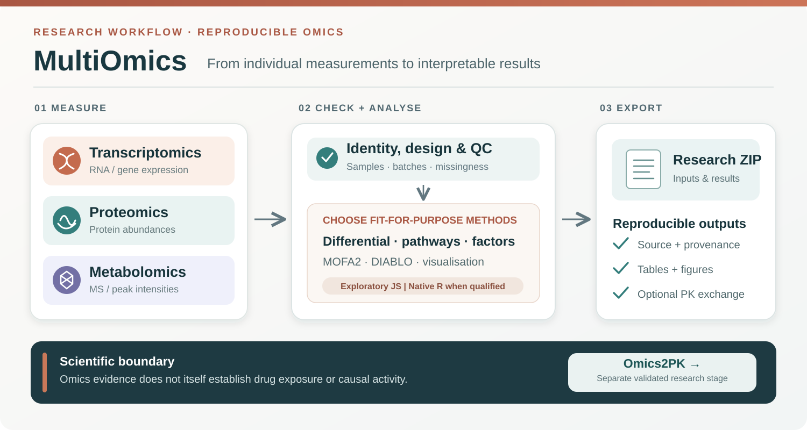

# MultiOmics



[View full-size graphical abstract](docs/assets/multiomics-graphical-abstract.svg) · [Open analysis tool](https://rberrah.github.io/multiomics/tool/) · [Omics2PK research consumer](https://github.com/rberrah/Omics2PK)

A public, source-available research environment for reproducible **single- and multi-omics research**, with an optional local R reference engine.

**Release status:** **Research v1 / software 1.0.0 is frozen** at commit `54dc8f0f8284cf970ed1a5be0533a298ae27639d` and the immutable branch `release/research-v1.0.0`. The current `main` line is **post-v1 development (`1.1.0-dev.0`)**; new output/interop improvements must not be retroactively described as part of the frozen 1.0.0 baseline. The v1 evidence contracts and known limitations remain recorded by [the Research v1 release note](docs/multiomics/RESEARCH_V1_FREEZE_20261019.md) and [machine-readable manifest](research-v1-manifest.json). The preferred public route is [`/multiomics/`](https://rberrah.github.io/multiomics/) and its [analysis tool](https://rberrah.github.io/multiomics/tool/); deployment is a separate pinned-SHA PMx integration step. This is **not** universal confirmatory statistical validation, clinical certification, or a hosted R service.

**Scope of the graphical abstract:** a *research workflow*, not an assertion that all assay-to-PK integrations or inferential methods are clinically validated. Importing, QC and exporting molecular values do not establish a patient's tacrolimus clearance or CYP3A4/5 activity.

## Download and use independently

The repository is public, but the current original work is under **noncommercial**
licenses rather than an OSI-approved open-source license. Earlier MIT and
CC BY-SA grants remain valid on the versions originally released under them.
See [the licensing scope](LICENSING.md), [the attribution notice](NOTICE)
and [the current code license](LICENSE).

Download the **complete source** with **Code → Download ZIP** on [GitHub](https://github.com/rberrah/MultiOmics), or clone it with:

```bash
git clone https://github.com/rberrah/MultiOmics.git
cd MultiOmics
npm ci
npm run dev
```

The repository ZIP includes the SvelteKit application, scientific R source, example CSVs, tests and documentation. Node.js 22.17 or newer (Node 24 recommended) and npm are needed to develop or build the site. The optional R/Bioconductor reference engine has its own package dependencies (see below).

For a **portable, browser-only download**, use the GitHub Actions artifact named `MultiOmics-portable-web-<commit SHA>` from a successful [standalone software qualification run](https://github.com/rberrah/MultiOmics/actions/workflows/standalone-ci.yml). Extract `MultiOmics-portable-web.zip`, enter its `MultiOmics-portable-web` directory, then run:

```bash
node serve.mjs
```

Open `http://127.0.0.1:4173/multiomics/tool/`. This package needs Node.js 22+ but **no npm installation, PMx Explain source, R installation or development dependencies**. It is a locally served static website: double-clicking an HTML file under `file://` is not a supported way to launch SvelteKit.

To create exactly that distributable from a full source checkout, use:

```bash
npm ci
npm run build:portable
```

This additional packaging command uses Python 3's **standard library** to produce `release/MultiOmics-portable-web.zip` and a SHA-256 checksum. The package contains the legally required code/content licenses, licensing scope, attribution notice and citation metadata, all covered by its SHA-256 manifest; it is tested with a real local HTTP server and Chromium in CI. Actions artifacts expire; for permanent redistribution publish a vetted versioned GitHub Release after full qualification.

The browser package supports exploratory workflows and research exports. **It does not package or emulate a native R backend.** For reference analyses install the packages under `multiomics-engine/`, and make a deliberate local/authorized backend connection.

## Relation to PMx Explain

MultiOmics shares PMx Explain's editorial design system (Source Serif 4,
Inter, terracotta mark, responsive margins, FR/EN and light/dark preferences)
but remains a **smaller research tool devoted to omics and PK/PD hypothesis
generation**, not a second copy of PMx. The header includes direct resources,
cross-disciplinary links, PMx Explain and the main website. Scientific
hypotheses from omics are **not automatically PK/PD covariates or validated
pharmacokinetic models**.

## Analyse in a browser

MultiOmics supports transcriptomics, proteomics and metabolomics (one, two or three layers). Import sample metadata and measurement matrices, or try the four built-in synthetic demos. The three individual-omics buttons sit above a wider multi-omics button.

JavaScript models are **deterministic exploratory calculations** and may differ materially from suitable reference methods. For supported scientific inference, select a valid study design and connect the real R backend. This is not a claim that a low adjusted p-value proves causality, a calibrated 5% FDR under all designs or clinical usefulness.

## Run the autonomous website locally

Requires Node.js 22 and npm.

```bash
npm ci
npm run check
npm run dev
```

Open the local address shown by Vite and choose `/multiomics/`, `/multiomics/tool/` or `/multiomics/learn/`. The site requires **no PMx Explain checkout**.

```bash
npm run test:multiomics
npm run build
npx playwright install chromium
npx playwright test --config playwright.multiomics.config.js tests/e2e/multiomics-methods-learning.spec.js
```

**The canonical destination is `/multiomics/` with `/tool/`, `/learn/`, `/resources/` and `/disciplines/`; the legacy `/pharmacometrie/multiomics/` remains a supported compatibility URL.** The standalone project produces a namespaced static compatibility payload instead of redirecting users to GitHub project Pages:

```bash
BASE_PATH=/pharmacometrie npm run build
node scripts/build_pmx_compat_overlay.mjs
node scripts/test_pmx_compat_overlay.mjs
```

This command does **not** publish or modify PMx Explain. The public hosting integration was merged via [PMx Explain PR #116](https://github.com/rberrah/rberrah.github.io/pull/116), and its post-deployment smoke via [PR #117](https://github.com/rberrah/rberrah.github.io/pull/117). PMx publishes a **pinned, independently qualified source commit** and adds only the verified pages and `_multiomics_app` assets. See [fixed public URL integration](docs/FIXED_PUBLIC_URL_INTEGRATION.md). A static Pages site **does not execute R on the server**.

## MultiOmics → Omics2PK: qualified boundary

MultiOmics is the **omics producer**, not a PopPK engine. On authorized, genuinely individual molecular assays it can export a versioned `DOWNSTREAM_EXCHANGE_V1` folder containing `manifest.json`, `samples.csv`, `features.csv` and assay matrices. The [contract](docs/multiomics/DOWNSTREAM_EXCHANGE_V1.md) records original sample and feature identifiers, measurement scale and checksums.

The separate [Omics2PK](https://github.com/rberrah/Omics2PK) consumer independently checks identity, source provenance, timing and availability of **authentic measured pharmacokinetics**; there is no automatic `MultiOmics → validated tacrolimus clearance` path. The key hypothesis is whether measured pre-landmark RNA, protein or metabolites improve tacrolimus prediction beyond the **same patients' clinical and CYP3A4/5 pharmacogenetic reference**.

- Group-level differential results (logFC, q-values) are **not** patient-level PK covariates.
- `individual_signatures.csv` is optional and valid only when a real frozen or out-of-fold individual-score model and its training provenance are available; schema checks alone cannot prove absence of leakage.
- SWEET-style RNA networks are **not** a metabolomics reconstruction method. Sample tissue, visits, treatments and batch are explicit; a categorical label such as `T0` is **not** an automatically inferred elapsed time since dose.
- Patient-level original source ZIPs and linked clinical PK/PGx data must remain in authorized private research storage; no transfer into public issues, repositories or CI artifacts.

**Current scientific gate:** independent Omics2PK CYP3A/midazolam and metformin patient-heldout exploratory pilots have not shown meaningful incremental PK gains from the tested global metabolomic PCA. Public BIOMARGIN omics can support source QC and multi-view research methods, but an authenticated `GEO → BIOS → ABIS` identity/PK crosswalk is still needed for a direct tacrolimus endpoint. See the [source-qualified Omics2PK audit](https://github.com/rberrah/Omics2PK/blob/main/docs/BIOMARGIN_131_REAL_PUBLIC_COUNTS_AND_GEO_BIOS_CROSSWALK_20261019.md).

## Confirmatory result display gate

Confirmatory display is **fail-closed** and currently supports only three
feature-wise native-R contracts:

- **Group comparisons:** every analysed omics layer must expose its complete
  native differential table (DESeq2/voom for compatible raw-count RNA-seq,
  limma for compatible processed layers).
- **Longitudinal group-by-time analysis:** every analysed layer must expose its
  complete `lmerTest` interaction table after the strict repeated-measures
  design checks. The coefficient is a group-by-time slope difference, not a
  generic fold change.
- **Survival outcome:** every analysed layer must expose its complete
  `survival::coxph` table, including event counts and proportional-hazards
  diagnostics. The feature coefficient is on the log-hazard scale.

A successful connection, one successful R method, or a single R layer beside
exploratory browser-only layers is never sufficient. Continuous, binary,
count and multiclass outcome-association tables remain exploratory until their
own native R projection contracts are implemented and independently checked.
Even a complete native table is not a statistical certificate: study design,
assumptions, multiplicity, missingness and biological conclusions still
require independent scientific review. See the
[release acceptance and deployment handoff](docs/multiomics/RESEARCH_V1_CONFIRMATORY_RELEASE_GATE.md).

## Optional native R reference engine

Install R and the required packages on your own machine:

```bash
Rscript multiomics-engine/install_backend_dependencies.R
Rscript multiomics-engine/run_backend.R
```

Use the **local** engine (default `http://127.0.0.1:8787`) only after checking its health in the UI. In formal/reference mode, a missing or incompatible backend must **block** native inference; it must not be silently replaced with exploratory JavaScript. Do not enter a remote R URL for confidential datasets unless institutional authorization and a privacy review exist. Consult [engine instructions](multiomics-engine/README.md) and [scientific limitations](static/multiomics/scientific-validation.md).

## Export as a reproducible research project

The research ZIP contains original inputs, complete native R result tables **when actually available**, source/version provenance and checksums, and a commented R Markdown report.

After extracting a ZIP into a local directory:

```bash
Rscript run_all.R
Rscript render_notebook.R
```

The second command installs missing **reporting** dependencies where supported, requires Pandoc, reruns supported reference R calculations and creates `analyse_reproductible.html`. Missing/mismatched scientific methods are **not** replaced with whatever package version is latest. Browser-only results are explicitly **not equivalent** to native R reference values.

## Scientific evidence and limits

- **Public Airway / GSE52778:** four biological cell lines measured twice; independent DESeq2 numerical comparison of **17,199 fitted genes**, native R vs website-plotted data (30 features × 8 samples) and archived research ZIP/Rmd replay in the original integrated CI. The independent R+Rmd CI has now succeeded on the migration branch ([run 38884213956](https://github.com/rberrah/MultiOmics/actions/runs/38884213956)); this is specific to the checked study and its environment, not universal validation.
- **MOFA2:** exploratory latent factors; batch adjustment, normalization and external replication matter.
- **DIABLO:** supervised learning needs patient-level splits, leakage controls and single-omic ablations. Its superiority is not universal.
- **False discovery rate:** stress simulations revealed possible inflation in some designs; an algorithm running successfully is not proof of 5% frequentist control. Document assumptions and uncertainty.

[Scientific release gates](docs/multiomics/RESEARCH_RELEASE_GATES.md) · [Public Airway evidence](docs/multiomics/PUBLIC_AIRWAY_SITE_R_REPLAY.md) · [Migration status](migration/STATUS.md).

## Provenance

The initial scientific snapshot contains **244 source-matched files** from `rberrah/rberrah.github.io` commit `dbe503f98cfde460f95a60617f3d743adb6b915b`, verified against immutable Git blob hashes. See `migration/source-snapshot-manifest.json`. Standalone adaptations are intentionally separate commits.

The portal continues to serve exactly the original MultiOmics URLs using a scoped namespaced overlay. Future MultiOmics changes require an updated immutable source pin and PMx build qualification; merging MultiOmics/main alone does not silently update the public site.
